# Faden – User Guide / Benutzerhandbuch

[English](#english) · [Deutsch](#deutsch)

---

## English

How to use “Faden”, page by page. Boxes marked **On a computer** or **On a
phone** describe what differs between the two; everything else works the same
everywhere.

### 1. What is Faden for?

Many todos can't be done right away: before the dishwasher can be loaded, the
dishes have to be collected; before that, the organic waste has to go out –
and so on. This chain is too long and invisible to keep in your head, so in the
end nothing happens at all.

**Faden makes the order visible and only ever shows you what is up next.** The
app remembers everything else for you. You never have to hold the whole mess in
your head at once.

Faden is deliberately calm: no alarms, no guilt, no pressure. Nothing gets
lost, and almost everything can be undone.

| Term | Meaning |
|---|---|
| **List** | A to-do list with a flow. You can have several lists side by side. |
| **Todo** | A single task on a list. |
| **Arrow** | “This todo only comes afterwards.” |
| **Now** | A todo whose prerequisites are all done. |
| **Strand** | A chain of connected todos. A list can contain several independent strands. |
| **Template** | A reusable structure from which you create new lists. |

### 2. Getting started

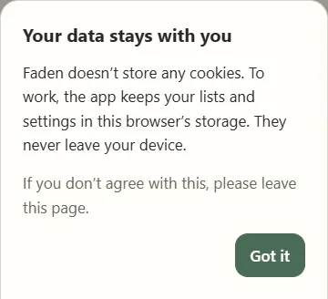

The very first time you open Faden, two notes appear one after the other:

1. **“Your data stays with you”**: Faden doesn't use cookies; it keeps your
   lists and settings in this browser's storage, and they never leave your
   device. **“Got it”** closes the note.
2. **“Read the guide?”**: **“Read the guide”** opens this guide,
   **“Ignore”** skips it. You can always find it under **Settings → Help**.

Both notes appear only once. Then:

1. Tap **“Create your first list”** (later: **“New list”**).
2. Enter a title, e.g. “Kitchen”. Every list needs its own name.
3. Optionally choose a **time planning** (section 7). The default is
   “No time planning”.
4. **“Create”** – the list opens, and you can write down the first todo.

### 3. The list overview

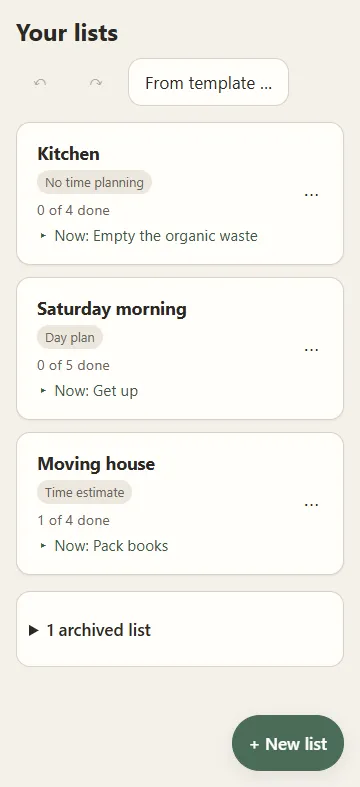

The start page shows all your lists as cards. Each card shows the **title**,
the **progress** (“1 of 4 done”), a **label** with its time planning (also
“No time planning”), and the todo that is **up now** – so you know what's next
without opening the list. Long titles are shortened to two lines. Tapping the
card opens it.

At the top are **Undo** (↶) and **Redo** (↷) for what you did in the overview,
and – once you have templates – **“From template …”**.

The **menu (⋯)** on a card offers:

- **Rename** – change title and time planning.
- **Duplicate** – a copy called “Name (2)”, “Name (3)” and so on.
- **Save list as template** (section 8).
- **Move up / Move down** – change the order.
- **Archive** – the list moves to the archive. Nothing is deleted.
- **Delete** – removes the list; **“Undo”** appears at the bottom for a few
  seconds.

Every menu (⋯) in the app closes when you tap anywhere outside it, tap the
three dots again or press **Esc**.

**Names:** every list needs a name, and two lists can't have the same name
(upper and lower case don't count). As long as the name is empty or taken, the
button stays disabled and a short hint below the field says why. The same
applies to templates.

**Finished lists archive themselves:** when you come back to the overview,
every list whose todos are all done moves to the archive, with **“Undo”** at
the bottom.

#### The archive

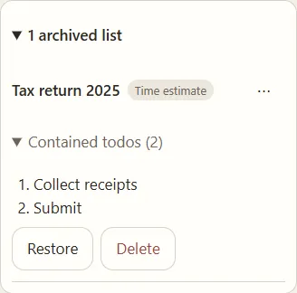

At the bottom of the overview, **“1 archived list”** expands the archive. Each
archived list shows its mode label and, expandable, **“Contained todos”** in
the order of the flow. **Restore** brings it back, **Delete** removes it. The
menu (⋯) has **Rename**, **Duplicate** (the copy starts fresh: not archived,
nothing checked off) and **Save list as template**.

> **On a phone:** **“+ New list”** is the round button at the bottom right.
> Dialogs slide in from the bottom.

> **On a computer:** **“New list”** is at the top right. An open list shows all
> your lists in a column on the left for switching quickly; **«** collapses it,
> **»** expands it again.

### 4. A list: “Now”

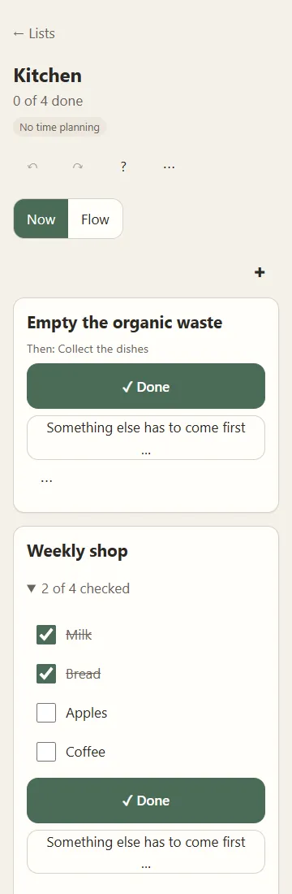

A list has two views, **Now** and **Flow**, switched just below the title. The
app remembers your choice per list. Above them are the title, the progress, the
mode label, Undo/Redo for this list, **?** (keyboard shortcuts) and the list
menu (⋯).

“Now” shows only the todos you can do right now, as large cards:

- **Done** checks the todo off. Checking off is always allowed, even if
  something before it is still open – Faden only points it out quietly
  (“Prerequisite still open”).
- **“Something else has to come first …”** puts a new prerequisite in front of
  this todo – the most important move in the app (see below).
- Below the title it says what comes next (“Then: …”) and, where branches come
  together, what else has to be done as well.
- The card menu (⋯) has **Edit**, **Insert after**, **Create successor task**,
  **Create predecessor task**, **Connect to another todo**, **Delete** and –
  if the todo has something before *and* after it – **Delete without
  reconnecting**.
- **✚** above the cards adds a new todo without prerequisites.
- **Checklists** show “2 of 4 checked”; tick the items right on the card, e.g.
  while shopping. That doesn't check off the todo itself.
- Collapsed below the cards: **“Still to come …”** with everything else.
- When everything is done, **“Archive list”** appears.

**Adding prerequisites in a flash:**

1. “Load the dishwasher” is up now.
2. **“Something else has to come first …”** opens the todo sheet → type
   “Collect the dishes” → **Enter**.
3. The sheet opens again right away, empty → “Empty the organic waste” →
   **Enter**.
4. Repeat as often as you like. **“Finish”** creates the last entry and closes
   the sheet; **“Cancel”** closes it without that entry.

Result: only the newest prerequisite is “Now”. Once it's checked off, the next
one moves up by itself.

> **On a computer** (keys changeable, section 12): **V** = something else has to come first, **N** = insert
> after, **E** = edit, **Enter/Space** = done, **Esc** ends a chain.

### 5. A list: “Flow”

“Flow” shows the whole list as a top-to-bottom diagram. Cards that are up now
are highlighted, waiting ones show a lock. Each card shows its state, its time
(if the list has one), a checklist counter (“☑ 2/4”) and a menu (⋯).

**Changing the structure** – every “+” opens the todo sheet (section 6):

- **“+” above a card** (at the start of a strand): insert *before*.
- **“+” on an arrow**: insert *in between*.
- **“+” below a card** (at the end of a strand or at a branch): insert
  *after*. At a branch, the new todo comes before **all** previous successors.
- **Tapping an arrow** offers **“Insert in between”** and **“Remove arrow”**.
- **The round circle** at the top left of a card checks it off – and back
  again.
- The card menu (⋯) has **Edit**, **Create successor task** (a parallel
  branch after it), **Create predecessor task** (something else that has to be
  done before it), **Connect to another todo**, **Save strand as template**,
  **Delete** and **Delete without reconnecting**; with a time planning also
  **Shift strand …** (section 7).

The buttons at the top right: **+** and **−** zoom, **⤢** fits everything into
view, **◎** jumps to the current todo, **✚** starts a **new separate strand**.
With a time planning, arrows show the **break** between two todos
(“Break 15 min”). If you zoom far out, the “+” and the breaks are hidden
(“Zoom in for “+””).

> **On a phone:** move the diagram with one finger, zoom with two.

> **On a computer:** drag with the mouse, zoom with **Ctrl + mouse wheel**.
> Arrow keys move between cards, **Enter** edits, **Delete** deletes (with
> undo).
>
> 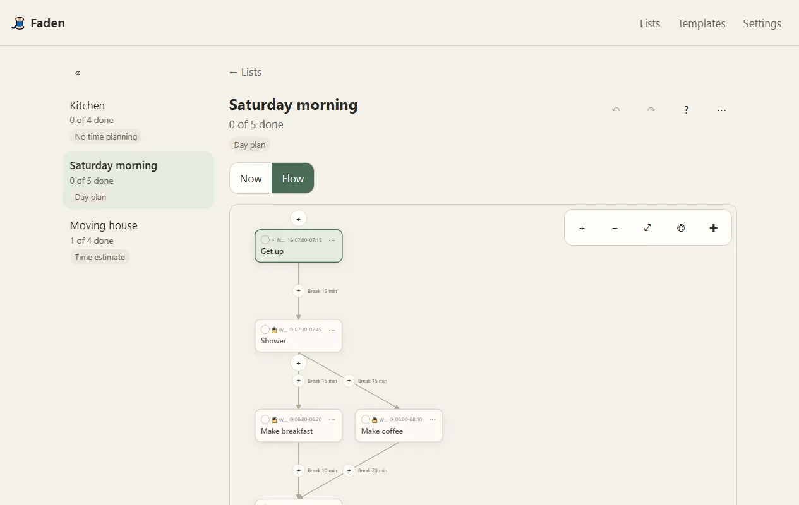

### 6. Creating and editing todos

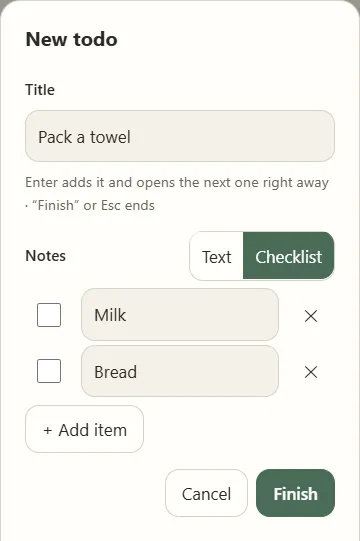

The same sheet creates and edits todos. Tapping a card (or **E**) opens it for
editing; every “+”, “✚” and “Create … task” opens it for a new todo.

- **Title** – required. When creating, **Enter** creates the todo right away;
  in a chain (“Now”) the next empty sheet follows. Pasting several lines
  creates one todo per line, as a chain.
- **Notes** – switch between **Text** and **Checklist**:
  - *Text*: free notes.
  - *Checklist*: one item per line with a checkbox. **Enter** in an item adds
    one below it, **✕** removes it, **“Add item”** adds one at the end. Empty
    items are dropped when saving.
  - Switching keeps the content: a checklist becomes bullet points
    (“- Milk”), and each line of a text becomes an item. Checkmarks are lost
    when switching to text.
- **Time** – only with a time planning: a single summary line such as
  “14:30 · 30 min”; tap it to show the fields (section 7). When creating in a
  day plan or fixed schedule it is already open.
- **When editing** also **“Must be done before”** and **“Comes after”**: add
  or remove connections without any dragging.

### 7. Time planning

Each list has its own time planning, changeable at any time under the list
menu → **Rename**. Switching never loses data. There is **no timer and no
notification** – Faden just does the maths.

- **No time planning** – just todos.
- **Time estimate** – a **duration** per todo (5–90 min or custom). The list
  shows totals: open, total, done and “3 without estimate”; with several
  strands, the Flow shows a subtotal above each.
- **Day plan** – a **start time** (without a date) and a duration; a todo has
  to end by midnight. Todos are “Now, until …”, “Next at …” or “Not checked
  off” (then with **“Check off afterwards”**). The times apply to the day you
  switched the day plan on; once that day is over, the app offers
  **“Set to today”**.
- **Fixed schedule** – start **date and time** plus a duration; a todo may run
  over midnight or several days.

The duration is the same field in every mode: an estimate becomes the duration
of a day plan, and vice versa.

#### Inserting with relative times

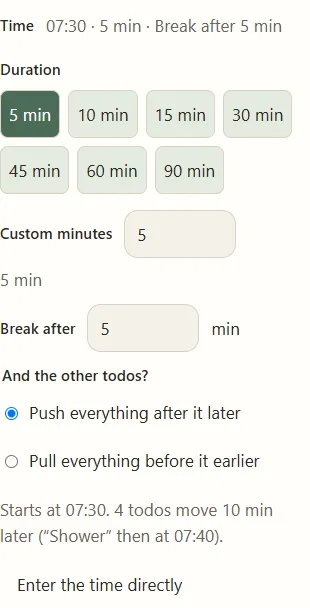

If you insert a todo next to todos that already have a start time, you don't
type a time of day. Instead:

- **Before the first todo:** duration and **break after**. Choose
  *“Schedule it before”* (it ends that break before the old start) or
  *“Keep the start time”* (it starts then, and the rest of the strand moves
  later).
- **After the last todo:** **break before** and duration.
- **In between:** duration and **break after**. The old break stays in front of
  the new todo. Choose *“Push everything after it later”* or *“Pull everything
  before it earlier”*. At a branch, the earliest next todo counts, and all of
  them move by the same amount.

A line below tells you when the new todo starts and who moves where. Only the
own strand ever moves. **“Enter the time directly”** switches to a normal start
time field. **Undo** reverts the insertion and the shifting in one step.

#### Editing the schedule

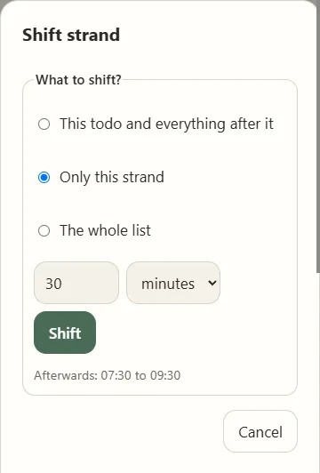

In a day plan or fixed schedule, the list menu (⋯) has **“Edit schedule”**:

- **Shift everything** by minutes, hours or (fixed schedule) days. A preview
  shows the first and last time afterwards. “+1 day” keeps the time of day,
  even across the change to or from daylight saving time.
- **Stretch to a period** (fixed schedule) – set a new start and end; the
  times in between move proportionally.
- **Propose times from estimates** – open todos are placed one after another
  from a start time (todos without a duration count as 15 min).
- **Transfer times of day onto a date** (day plan) – copies the start times as
  date + time.

To shift only **one strand**, open **⋯ → “Shift strand …”** on one of its cards
in the Flow; you can still switch to the whole list there. In a day plan,
nothing may move past 0:00 or 24:00 – Faden says so and changes nothing.

When you switch a list from day plan to fixed schedule, the app offers to
transfer the times onto a date right away. The other way round nothing is lost:
the dates stay saved for when you switch back.

### 8. Templates

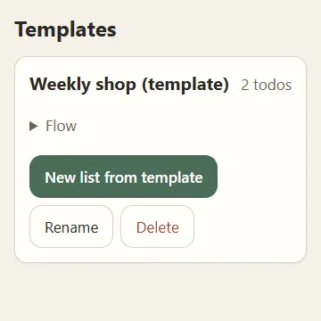

Save a whole list **or** a single strand as a **template**:

- **Whole list:** list menu (⋯) → **“Save list as template”**, or in the
  overview from the card menu.
- **One strand:** in the Flow, card menu (⋯) → **“Save strand as template”**.

Templates keep structure, titles, notes, checklists (unchecked), durations,
times of day and the time planning – but not what was already done. Template
names are unique like list names: saving a second “Weekly shop” creates
“Weekly shop (2)”.

On the **Templates** page you can expand the **Flow** of a template as a
preview, **Rename** or **Delete** it (with Undo) and create a
**“New list from template”**. In an open list, the menu has **“Insert template
into list”**: the template is added as a new, separate strand.

### 9. Settings

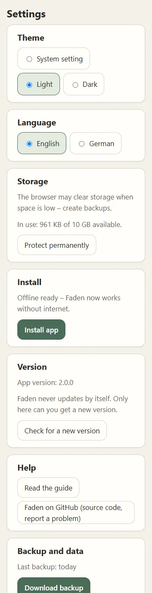

- **Theme** – system setting, light or dark.
- **Language** – English or German, takes effect immediately.
- **Storage** – how much space Faden uses and whether the browser protects it
  permanently. If not, **“Protect permanently”** asks the browser.
- **Install** – shows **“Offline ready”** once Faden is completely stored on
  your device, plus **“Install app”** where the browser offers it.
- **Version** – the installed version. **“What's new?”** shows the changes of
  every version (also offline). Faden **never updates by itself**; **“Check
  for a new version”** asks, and a new version is only switched to once it has
  been downloaded completely.
- **Help** – **“Read the guide”** opens this guide in the app (also offline);
  **“Faden on GitHub”** opens the source code and the place to report problems.
- **Advanced** – settings most people never need; for now the keyboard
  shortcuts (section 12).
- **Backup and data** – section 10.

> **On a phone (iPhone/iPad):** in Safari, **Share → Add to Home Screen**
> installs Faden. Important: Safari deletes data of websites that haven't been
> used for about 7 days – only the installed app is reliably protected.

While Faden runs in a browser tab and can be installed, a notice **“Install
Faden as an app”** appears at the top. After **“Ignore”** it doesn't come back.

### 10. Data, backup and offline

All data stays **on your device** (in the browser's IndexedDB). There is no
account and no cloud. After loading once, Faden works **without a network** –
even if the website it came from no longer exists.

- **“Download backup”** saves `faden-backup-YYYY-MM-DD.json` and remembers the
  date (“Last backup: today”). **“Share backup”** uses the device's share
  feature, where available.
- **“Restore a backup”** checks the chosen file completely, names it, and
  offers **“Merge”** (adds it to your data) or **“Replace everything”** (your
  current data is downloaded as a backup first).
- If more than 30 days have passed since the last backup, the overview shows a
  quiet reminder once a week.
- Several open tabs stay in sync by themselves.

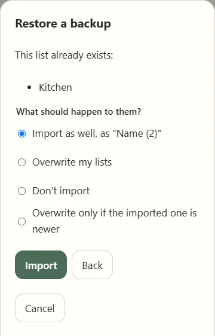

**Same names when merging:** if the backup contains lists whose names you
already have, Faden lists them and asks **once for all of them**: *import as
well* as “Name (2)”, *overwrite my lists* (the content is replaced, the list
keeps its place), *don't import*, or *overwrite only if the imported one is
newer*. Before overwriting, a backup of your data is downloaded. Afterwards a
note says e.g. “5 imported, 2 skipped, 1 overwritten”.

### 11. Undo and redo

Almost every change can be undone – creating, renaming, archiving, deleting,
checking off, inserting, shifting.

- **Inside a list**, ↶/↷ affect only **this list** (the last 100 steps).
- **In the overview**, they affect what you did there; changes inside lists
  stay.
- After deleting or checking off, a calm notice with **“Undo”** appears at the
  bottom. It doesn't block anything and disappears by itself.

### 12. Keyboard

> **On a computer:**
> - **Tab / Shift+Tab** move through the controls; every control shows a
>   clear focus ring. **Enter/Space** press the focused button, e.g. “Done”.
> - In “Now”: **V** = something else has to come first, **N** = insert after,
>   **E** = edit.
> - In the Flow (on a focused card): arrow keys move between cards, **Enter**
>   edits, **Delete** deletes.
> - **Ctrl/Cmd+Z** = undo, **Ctrl/Cmd+Shift+Z** or **Ctrl+Y** = redo.
> - **?** shows all shortcuts with their current keys. **Esc** closes menus
>   and dialogs.

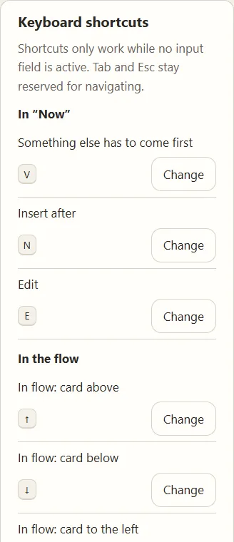

**Changing shortcuts:** under **Settings → Advanced**, tap **“Change”** next to
an action and press the new key or combination (**Esc** cancels). Faden
refuses keys that are already used where the action works, and **Tab** and
**Esc**, which stay reserved for navigating. Changed shortcuts are marked
“changed”; **“Default”** resets one, **“Reset all to default”** all of them.
Shortcuts only work while no input field is active.

### 13. If something goes wrong

- **Deleted or checked off by mistake:** **“Undo”** in the notice, or ↶.
- **“Saving failed”:** reload the page and create a backup as soon as
  possible.
- **Data gone after a long break (iPhone/iPad):** Safari removes data of
  websites not used for about a week. Install Faden (section 9) and restore
  your last backup.
- **A problem or an idea:** **Settings → Help → “Faden on GitHub”**.

---

## Deutsch

So bedienst du „Faden“, Seite für Seite. Kästen mit **Am PC** oder **Auf dem
Handy** beschreiben, was sich unterscheidet; alles andere funktioniert überall
gleich.

### 1. Wozu ist Faden da?

Viele ToDos sind nicht sofort machbar: Bevor die Spülmaschine eingeräumt werden
kann, muss Geschirr eingesammelt werden, davor der Biomüll raus – und so
weiter. Diese Kette ist im Kopf zu lang und unsichtbar, deshalb passiert am Ende
gar nichts.

**Faden macht die Reihenfolge sichtbar und zeigt dir immer nur das, was jetzt
dran ist.** Alles andere merkt sich die App für dich. Du musst nie das ganze
Durcheinander gleichzeitig im Kopf halten.

Faden ist bewusst ruhig: keine Alarme, keine Schuldgefühle, kein Gedrängel.
Nichts geht verloren, und fast alles lässt sich rückgängig machen.

| Begriff | Bedeutung |
|---|---|
| **Zettel** | Eine ToDo-Liste mit Ablauf. Du kannst mehrere Zettel nebeneinander haben. |
| **ToDo** | Eine einzelne Aufgabe auf einem Zettel. |
| **Pfeil** | „Dieses ToDo kommt erst danach.“ |
| **Jetzt dran** | Ein ToDo, dessen Vorarbeiten alle erledigt sind. |
| **Strang** | Eine Kette verbundener ToDos. Ein Zettel kann mehrere unabhängige Stränge enthalten. |
| **Vorlage** | Eine wiederverwendbare Struktur, aus der du neue Zettel anlegst. |

### 2. Erste Schritte

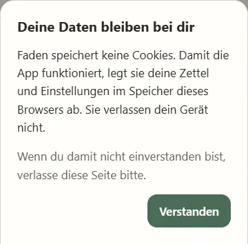

Beim allerersten Öffnen erscheinen nacheinander zwei Hinweise:

1. **„Deine Daten bleiben bei dir“**: Faden nutzt keine Cookies; deine Zettel
   und Einstellungen liegen im Speicher dieses Browsers und verlassen dein
   Gerät nicht. **„Verstanden“** schließt den Hinweis.
2. **„Anleitung lesen?“**: **„Anleitung lesen“** öffnet diese Anleitung,
   **„Ignorieren“** überspringt sie. Du findest sie jederzeit unter
   **Einstellungen → Hilfe**.

Beide Hinweise kommen nur einmal. Danach:

1. **„Ersten Zettel anlegen“** antippen (später: **„Neuer Zettel“**).
2. Einen Titel eingeben, z. B. „Küche“. Jeder Zettel braucht einen eigenen
   Namen.
3. Optional eine **Zeitplanung** wählen (Abschnitt 7). Standard ist „Keine
   Zeitplanung“.
4. **„Anlegen“** – der Zettel öffnet sich, und du kannst das erste ToDo
   eintragen.

### 3. Die Zettel-Übersicht

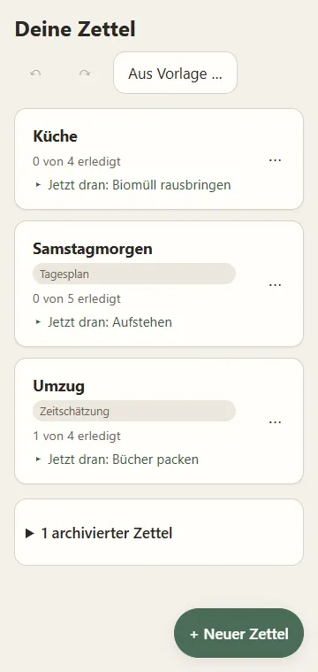

Die Startseite zeigt alle Zettel als Karten. Jede Karte zeigt den **Titel**,
den **Fortschritt** („1 von 4 erledigt“), ein **Etikett** mit seiner
Zeitplanung (auch „Keine Zeitplanung“) und das ToDo, das **jetzt dran** ist – so
weißt du, was als Nächstes kommt, ohne den Zettel zu öffnen. Lange Titel werden
auf zwei Zeilen gekürzt. Ein Tipp auf die Karte öffnet ihn.

Oben stehen **Rückgängig** (↶) und **Wiederholen** (↷) für das, was du in der
Übersicht getan hast, und – sobald es Vorlagen gibt – **„Aus Vorlage …“**.

Das **Menü (⋯)** einer Karte bietet:

- **Umbenennen** – Titel und Zeitplanung ändern.
- **Duplizieren** – eine Kopie namens „Name (2)“, „Name (3)“ usw.
- **Zettel als Vorlage speichern** (Abschnitt 8).
- **Nach oben / Nach unten** – Reihenfolge ändern.
- **Archivieren** – der Zettel kommt ins Archiv. Nichts wird gelöscht.
- **Löschen** – entfernt den Zettel; unten erscheint für ein paar Sekunden
  **„Rückgängig“**.

Jedes Menü (⋯) in der App schließt sich, wenn du irgendwo daneben tippst, noch
einmal auf die drei Punkte tippst oder **Esc** drückst.

**Namen:** Jeder Zettel braucht einen Namen, und zwei Zettel können nicht gleich
heißen (Groß- und Kleinschreibung zählen nicht). Solange der Name leer oder
vergeben ist, bleibt der Knopf gesperrt, und ein kurzer Hinweis unter dem Feld
sagt warum. Für Vorlagen gilt dasselbe.

**Fertige Zettel archivieren sich selbst:** Kommst du zurück in die Übersicht,
wandert jeder Zettel, dessen ToDos alle erledigt sind, ins Archiv – mit
**„Rückgängig“** unten.

#### Das Archiv

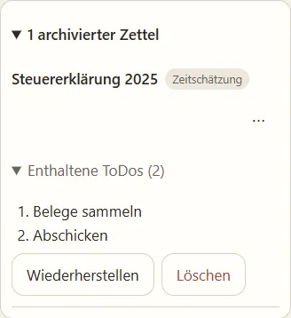

Unten in der Übersicht klappt **„1 archivierter Zettel“** das Archiv auf. Jeder
archivierte Zettel zeigt sein Modus-Etikett und, aufklappbar, die **„Enthaltenen
ToDos“** in der Reihenfolge des Ablaufs. **Wiederherstellen** holt ihn zurück,
**Löschen** entfernt ihn. Das Menü (⋯) hat **Umbenennen**, **Duplizieren** (die
Kopie startet frisch: nicht archiviert, nichts abgehakt) und **Zettel als
Vorlage speichern**.

> **Auf dem Handy:** **„+ Neuer Zettel“** ist der runde Knopf unten rechts.
> Dialoge kommen von unten herein.

> **Am PC:** **„Neuer Zettel“** steht oben rechts. Ein geöffneter Zettel zeigt
> links eine Spalte mit allen Zetteln zum schnellen Wechseln; **«** klappt sie
> ein, **»** wieder aus.

### 4. Ein Zettel: „Jetzt dran“

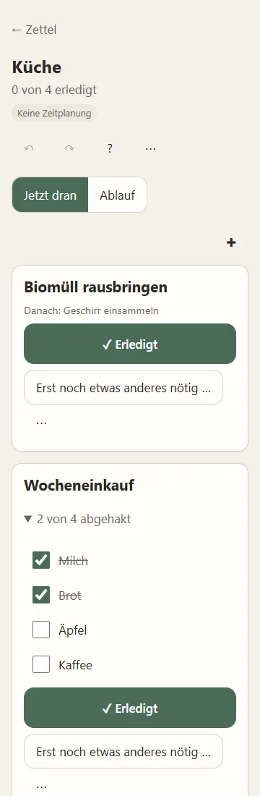

Ein Zettel hat zwei Ansichten, **Jetzt dran** und **Ablauf**, umschaltbar direkt
unter dem Titel. Die App merkt sich deine Wahl je Zettel. Darüber stehen Titel,
Fortschritt, Modus-Etikett, Rückgängig/Wiederholen für diesen Zettel, **?**
(Tastenkürzel) und das Zettel-Menü (⋯).

„Jetzt dran“ zeigt nur die ToDos, die du gerade machen kannst, als große Karten:

- **Erledigt** hakt das ToDo ab. Abhaken geht immer, auch wenn davor noch etwas
  offen ist – Faden weist nur leise darauf hin („Vorarbeit noch offen“).
- **„Erst noch etwas anderes nötig …“** setzt eine neue Vorarbeit davor – der
  wichtigste Handgriff der App (siehe unten).
- Unter dem Titel steht, was danach kommt („Danach: …“), und wo Zweige
  zusammenlaufen, was außerdem noch erledigt sein muss.
- Das Karten-Menü (⋯) hat **Bearbeiten**, **Danach einfügen**,
  **Nachfolgeaufgabe erstellen**, **Voraufgabe erstellen**, **Mit anderem ToDo
  verbinden**, **Löschen** und – wenn das ToDo etwas davor *und* danach hat –
  **Löschen, ohne zu verbinden**.
- **✚** über den Karten legt ein neues ToDo ohne Vorarbeit an.
- **Checklisten** zeigen „2 von 4 abgehakt“; die Punkte hakst du direkt auf der
  Karte ab, z. B. beim Einkaufen. Das hakt nicht das ToDo selbst ab.
- Unter den Karten eingeklappt: **„Danach kommt noch …“** mit allem Übrigen.
- Ist alles erledigt, erscheint **„Zettel archivieren“**.

**Vorarbeit blitzschnell eintragen:**

1. „Spülmaschine einräumen“ ist jetzt dran.
2. **„Erst noch etwas anderes nötig …“** öffnet das ToDo-Sheet → „Geschirr
   einsammeln“ tippen → **Enter**.
3. Das Sheet öffnet sich sofort wieder, leer → „Biomüll rausbringen“ →
   **Enter**.
4. So oft du willst. **„Fertig“** legt den letzten Eintrag an und schließt das
   Sheet; **„Abbrechen“** schließt es ohne diesen Eintrag.

Ergebnis: Nur die neueste Vorarbeit ist „Jetzt dran“. Ist sie abgehakt, rückt
die nächste von selbst nach.

> **Am PC** (Tasten änderbar, Abschnitt 12): **V** = erst noch etwas anderes nötig, **N** = danach einfügen,
> **E** = bearbeiten, **Enter/Leertaste** = erledigt, **Esc** beendet eine
> Kette.

### 5. Ein Zettel: „Ablauf“

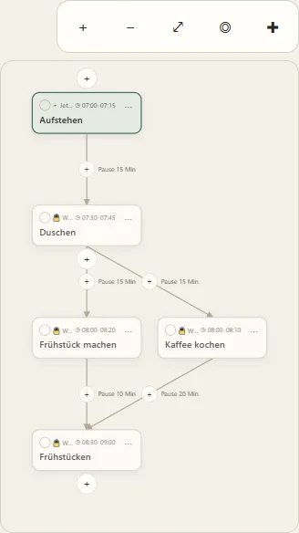

„Ablauf“ zeigt den ganzen Zettel als Diagramm von oben nach unten. Was jetzt
dran ist, ist hervorgehoben; Wartendes trägt ein Schloss. Jede Karte zeigt
ihren Zustand, ihre Zeit (falls der Zettel eine hat), einen Checklisten-Zähler
(„☑ 2/4“) und ein Menü (⋯).

**Struktur ändern** – jedes „+“ öffnet das ToDo-Sheet (Abschnitt 6):

- **„+“ über einer Karte** (am Anfang eines Strangs): *davor* einfügen.
- **„+“ auf einem Pfeil**: *dazwischen* einfügen.
- **„+“ unter einer Karte** (am Ende eines Strangs oder an einer Verzweigung):
  *danach* einfügen. An einer Verzweigung kommt das neue ToDo vor **alle**
  bisherigen Nachfolger.
- **Ein Tipp auf einen Pfeil** bietet **„Dazwischen einfügen“** und **„Pfeil
  entfernen“**.
- **Der runde Kreis** oben links auf einer Karte hakt sie ab – und wieder auf.
- Das Karten-Menü (⋯) hat **Bearbeiten**, **Nachfolgeaufgabe erstellen** (ein
  paralleler Zweig danach), **Voraufgabe erstellen** (noch etwas, das davor
  erledigt sein muss), **Mit anderem ToDo verbinden**, **Strang als Vorlage
  speichern**, **Löschen** und **Löschen, ohne zu verbinden**; mit Zeitplanung
  außerdem **Strang verschieben …** (Abschnitt 7).

Die Knöpfe oben rechts: **+** und **−** zoomen, **⤢** passt alles ein, **◎**
springt zum aktuellen ToDo, **✚** beginnt einen **neuen eigenen Strang**. Mit
Zeitplanung zeigen die Pfeile die **Pause** zwischen zwei ToDos („Pause
15 Min“). Zoomst du weit heraus, werden die „+“ und die Pausen ausgeblendet
(„Für „+“ heranzoomen“).

> **Auf dem Handy:** Mit einem Finger verschieben, mit zwei Fingern zoomen.

> **Am PC:** Mit der Maus ziehen, mit **Strg + Mausrad** zoomen. Pfeiltasten
> wechseln zwischen Karten, **Enter** bearbeitet, **Entf** löscht (mit
> Rückgängig).
>
> 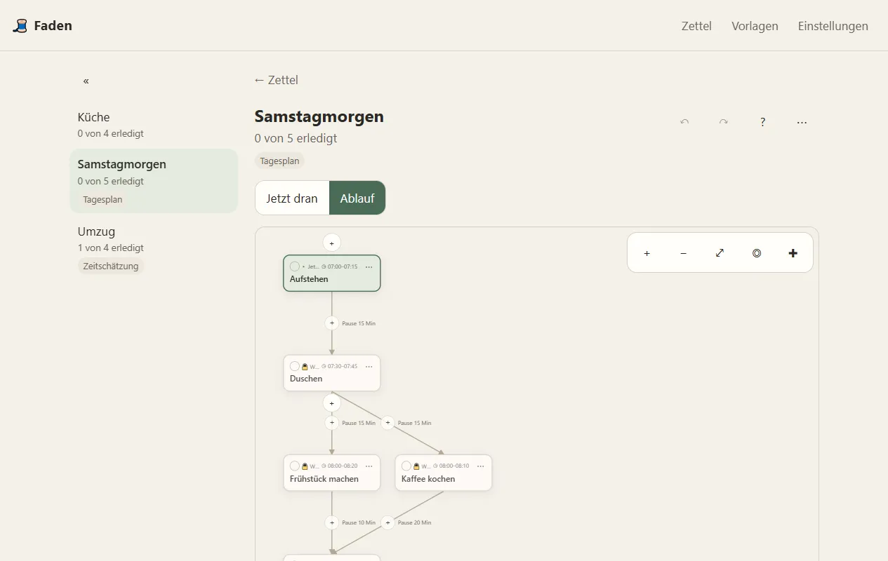

### 6. ToDos anlegen und bearbeiten

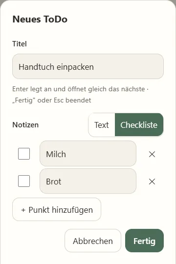

Dasselbe Sheet legt ToDos an und bearbeitet sie. Ein Tipp auf eine Karte (oder
**E**) öffnet es zum Bearbeiten; jedes „+“, „✚“ und „… erstellen“ öffnet es für
ein neues ToDo.

- **Titel** – Pflicht. Beim Anlegen legt **Enter** das ToDo sofort an; in einer
  Kette („Jetzt dran“) folgt gleich das nächste leere Sheet. Mehrere eingefügte
  Zeilen werden zu je einem ToDo, als Kette.
- **Notizen** – umschaltbar zwischen **Text** und **Checkliste**:
  - *Text*: freie Notizen.
  - *Checkliste*: ein Punkt pro Zeile mit Haken. **Enter** in einem Punkt legt
    darunter einen neuen an, **✕** entfernt ihn, **„Punkt hinzufügen“** hängt
    einen an. Leere Punkte entfallen beim Speichern.
  - Beim Umschalten bleibt der Inhalt erhalten: Aus einer Checkliste werden
    Stichpunkte („- Milch“), aus jeder Zeile eines Textes ein Punkt. Haken
    gehen beim Wechsel zu Text verloren.
- **Zeit** – nur mit Zeitplanung: eine Zusammenfassungszeile wie
  „14:30 · 30 Min“; ein Tipp zeigt die Felder (Abschnitt 7). Beim Anlegen im
  Tagesplan oder festen Zeitplan ist sie schon aufgeklappt.
- **Beim Bearbeiten** außerdem **„Muss vorher erledigt sein“** und **„Kommt
  danach“**: Verbindungen ganz ohne Ziehen hinzufügen oder entfernen.

### 7. Zeitplanung

Jeder Zettel hat seine eigene Zeitplanung, jederzeit änderbar über das
Zettel-Menü → **Umbenennen**. Beim Wechsel geht nichts verloren. Es gibt
**keinen Timer und keine Benachrichtigung** – Faden rechnet nur mit.

- **Keine Zeitplanung** – nur ToDos.
- **Zeitschätzung** – eine **Dauer** je ToDo (5–90 Min oder frei). Der Zettel
  zeigt Summen: offen, gesamt, erledigt und „3 ohne Schätzung“; bei mehreren
  Strängen steht im Ablauf über jedem eine Teilsumme.
- **Tagesplan** – eine **Startzeit** (ohne Datum) und eine Dauer; ein ToDo muss
  spätestens um 24:00 enden. ToDos sind „Jetzt, bis …“, „Als Nächstes um …“
  oder „Nicht abgehakt“ (dann mit **„Nachträglich abhaken“**). Die Zeiten gelten für
  den Tag, an dem du den Tagesplan eingeschaltet hast; ist er vorbei, bietet
  die App **„Auf heute setzen“** an.
- **Fester Zeitplan** – Start mit **Datum und Uhrzeit** plus Dauer; ein ToDo
  darf über Mitternacht oder mehrere Tage gehen.

Die Dauer ist in allen Modi dasselbe Feld: Eine Schätzung wird im Tagesplan zur
Dauer und umgekehrt.

#### Einfügen mit relativen Zeiten

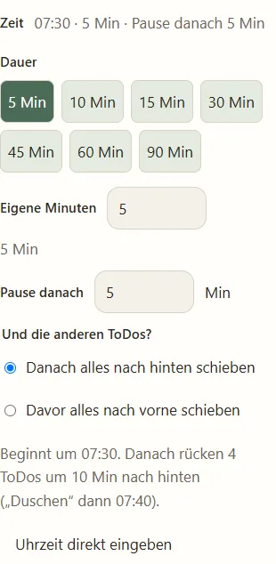

Fügst du ein ToDo neben ToDos ein, die schon eine Startzeit haben, tippst du
keine Uhrzeit ein, sondern:

- **Vor dem ersten ToDo:** Dauer und **Pause danach**. Wähle *„Davor
  einplanen“* (es endet diese Pause vor dem alten Start) oder *„Startzeit
  beibehalten“* (es beginnt dann, und der Rest des Strangs rückt nach hinten).
- **Nach dem letzten ToDo:** **Pause davor** und Dauer.
- **Dazwischen:** Dauer und **Pause danach**. Die bisherige Pause bleibt vor dem
  neuen ToDo. Wähle *„Danach alles nach hinten schieben“* oder *„Davor alles
  nach vorne schieben“*. An einer Verzweigung zählt das früheste nächste ToDo,
  und alle rücken gleich weit.

Eine Zeile darunter sagt dir, wann das neue ToDo beginnt und wer wohin rückt.
Verschoben wird immer nur im eigenen Strang. **„Uhrzeit direkt eingeben“**
wechselt zum normalen Startzeit-Feld. **Rückgängig** nimmt Einfügen und
Verschieben in einem Schritt zurück.

#### Zeitplan bearbeiten

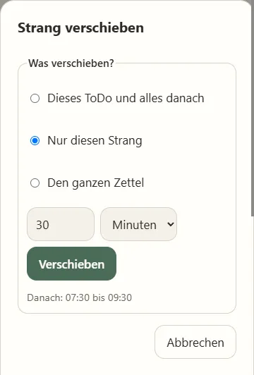

Im Tagesplan oder festen Zeitplan hat das Zettel-Menü (⋯) **„Zeitplan
bearbeiten“**:

- **Alles verschieben** um Minuten, Stunden oder (fester Zeitplan) Tage. Eine
  Vorschau zeigt die erste und letzte Zeit danach. „+1 Tag“ behält die Uhrzeit,
  auch über die Zeitumstellung.
- **Auf Zeitraum strecken** (fester Zeitplan) – neuen Start und neues Ende
  wählen; die Zeiten dazwischen rücken anteilig mit.
- **Zeiten aus Schätzungen vorschlagen** – offene ToDos werden ab einer
  Startzeit nacheinander abgelegt (ohne Dauer zählen 15 Min).
- **Tageszeiten auf ein Datum übertragen** (Tagesplan) – kopiert die
  Startzeiten als Datum + Uhrzeit.

Um nur **einen Strang** zu verschieben, öffne im Ablauf auf einer seiner Karten
**⋯ → „Strang verschieben …“**; dort kannst du auch auf den ganzen Zettel
umschalten. Im Tagesplan darf nichts über 0:00 oder 24:00 hinaus – Faden sagt
das und ändert nichts.

Wechselst du einen Zettel vom Tagesplan zum festen Zeitplan, bietet die App
gleich an, die Zeiten auf ein Datum zu übertragen. Umgekehrt geht nichts
verloren: Die Datumsangaben bleiben für den Rückweg gespeichert.

### 8. Vorlagen

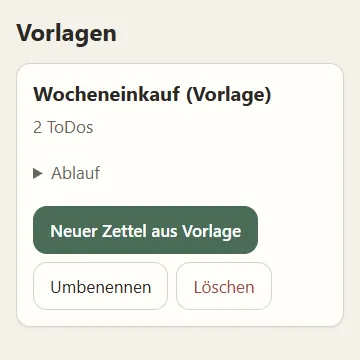

Speichere einen ganzen Zettel **oder** einen einzelnen Strang als **Vorlage**:

- **Ganzer Zettel:** Zettel-Menü (⋯) → **„Zettel als Vorlage speichern“**, oder
  in der Übersicht im Karten-Menü.
- **Ein Strang:** im Ablauf Karten-Menü (⋯) → **„Strang als Vorlage
  speichern“**.

Vorlagen behalten Struktur, Titel, Notizen, Checklisten (ohne Haken), Dauern,
Uhrzeiten und die Zeitplanung – aber nicht, was schon erledigt war.
Vorlagen-Namen sind eindeutig wie Zettel-Namen: Ein zweiter „Wocheneinkauf“ wird
zu „Wocheneinkauf (2)“.

Auf der Seite **Vorlagen** klappst du den **Ablauf** einer Vorlage als Vorschau
auf, kannst sie **Umbenennen** oder **Löschen** (mit Rückgängig) und mit
**„Neuer Zettel aus Vorlage“** einen Zettel anlegen. In einem geöffneten
Zettel hat das Menü **„Vorlage in Zettel einfügen“**: Die Vorlage kommt als
neuer, eigener Strang dazu.

### 9. Einstellungen

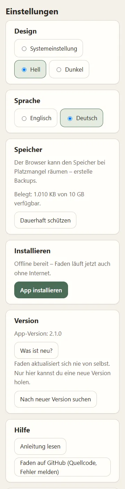

- **Design** – Systemeinstellung, hell oder dunkel.
- **Sprache** – Englisch oder Deutsch, wirkt sofort.
- **Speicher** – wie viel Platz Faden belegt und ob der Browser ihn dauerhaft
  schützt. Wenn nicht, fragt **„Dauerhaft schützen“** beim Browser nach.
- **Installieren** – zeigt **„Offline bereit“**, sobald Faden vollständig auf
  deinem Gerät liegt, und **„App installieren“**, wo der Browser es anbietet.
- **Version** – die installierte Version. **„Was ist neu?“** zeigt die
  Änderungen jeder Version (auch offline). Faden **aktualisiert sich nie von
  selbst**; **„Nach neuer Version suchen“** fragt nach, und auf eine neue
  Version wird erst umgeschaltet, wenn sie vollständig geladen ist.
- **Hilfe** – **„Anleitung lesen“** öffnet diese Anleitung in der App (auch
  offline); **„Faden auf GitHub“** öffnet den Quellcode und die Stelle zum
  Melden von Fehlern.
- **Für Fortgeschrittene** – Einstellungen, die die meisten nie brauchen;
  vorerst die Tastenkürzel (Abschnitt 12).
- **Sicherung und Daten** – Abschnitt 10.

> **Auf dem Handy (iPhone/iPad):** In Safari installiert **Teilen → Zum
> Home-Bildschirm** Faden. Wichtig: Safari löscht Daten von Websites, die etwa
> 7 Tage nicht benutzt wurden – nur die installierte App ist zuverlässig
> geschützt.

Solange Faden in einem Browser-Tab läuft und installierbar ist, erscheint oben
der Hinweis **„Faden als App installieren“**. Nach **„Ignorieren“** kommt er
nicht wieder.

### 10. Daten, Sicherung und Offline

Alle Daten bleiben **auf deinem Gerät** (in der IndexedDB des Browsers). Es gibt
kein Konto und keine Cloud. Nach einmaligem Laden läuft Faden **ohne Netz** –
auch wenn die Website, von der es kam, nicht mehr existiert.

- **„Sicherung herunterladen“** speichert `faden-backup-JJJJ-MM-TT.json` und
  merkt sich das Datum („Letztes Backup: heute“). **„Sicherung teilen“** nutzt
  die Teilen-Funktion des Geräts, wo vorhanden.
- **„Sicherung einspielen“** prüft die gewählte Datei vollständig, nennt sie
  und bietet **„Zusammenführen“** (ergänzt deine Daten) oder **„Alles
  ersetzen“** (deine aktuellen Daten werden vorher als Sicherung
  heruntergeladen).
- Liegt das letzte Backup mehr als 30 Tage zurück, erinnert die Übersicht einmal
  pro Woche leise daran.
- Mehrere offene Tabs bleiben von selbst auf demselben Stand.

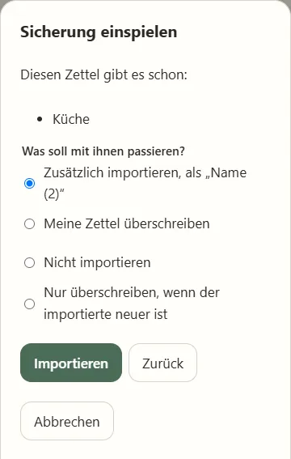

**Gleiche Namen beim Zusammenführen:** Enthält die Sicherung Zettel, deren
Namen du schon hast, zeigt Faden sie an und fragt **einmal für alle**:
*zusätzlich importieren* als „Name (2)“, *meine Zettel überschreiben* (der
Inhalt wird ersetzt, der Zettel bleibt an seinem Platz), *nicht importieren*
oder *nur überschreiben, wenn der importierte neuer ist*. Vor dem Überschreiben
wird eine Sicherung deiner Daten heruntergeladen. Danach steht z. B.
„5 importiert, 2 übersprungen, 1 überschrieben“.

### 11. Rückgängig und Wiederholen

Fast jede Änderung lässt sich zurücknehmen – Anlegen, Umbenennen, Archivieren,
Löschen, Abhaken, Einfügen, Verschieben.

- **In einem Zettel** wirken ↶/↷ nur auf **diesen Zettel** (die letzten 100
  Schritte).
- **In der Übersicht** wirken sie auf das, was du dort getan hast; Änderungen in
  den Zetteln bleiben.
- Nach dem Löschen oder Abhaken erscheint unten ein ruhiger Hinweis mit
  **„Rückgängig“**. Er blockiert nichts und verschwindet von selbst.

### 12. Tastatur

> **Am PC:**
> - **Tab / Umschalt+Tab** wechseln zwischen den Bedienelementen; jedes zeigt
>   einen deutlichen Fokusrahmen. **Enter/Leertaste** lösen den fokussierten
>   Knopf aus, z. B. „Erledigt“.
> - In „Jetzt dran“: **V** = erst noch etwas anderes nötig, **N** = danach
>   einfügen, **E** = bearbeiten.
> - Im Ablauf (auf einer fokussierten Karte): Pfeiltasten wechseln zwischen
>   Karten, **Enter** bearbeitet, **Entf** löscht.
> - **Strg/Cmd+Z** = rückgängig, **Strg/Cmd+Umschalt+Z** oder **Strg+Y** =
>   wiederholen.
> - **?** zeigt alle Tastenkürzel mit ihrer aktuellen Belegung. **Esc** schließt
>   Menüs und Dialoge.

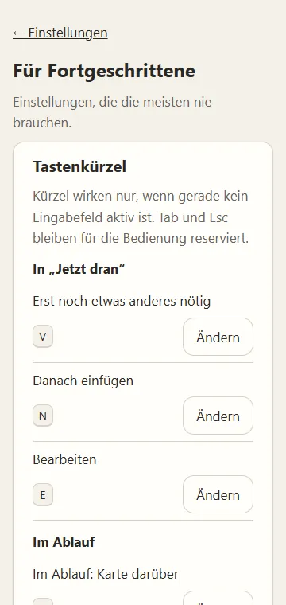

**Tastenkürzel ändern:** Unter **Einstellungen → Für Fortgeschrittene** tippst
du neben einer Aktion auf **„Ändern“** und drückst die neue Taste oder
Kombination (**Esc** bricht ab). Faden lehnt Tasten ab, die dort schon belegt
sind, wo die Aktion wirkt, sowie **Tab** und **Esc**, die für die Bedienung
reserviert bleiben. Geänderte Kürzel sind als „geändert“ markiert;
**„Standard“** setzt eines zurück, **„Alle auf Standard“** alle. Kürzel wirken
nur, wenn gerade kein Eingabefeld aktiv ist.

### 13. Wenn etwas schiefgeht

- **Versehentlich gelöscht oder abgehakt:** **„Rückgängig“** im Hinweis oder ↶.
- **„Speichern hat nicht geklappt“:** Seite neu laden und möglichst bald eine
  Sicherung erstellen.
- **Daten nach langer Pause weg (iPhone/iPad):** Safari entfernt Daten von
  Websites, die etwa eine Woche nicht benutzt wurden. Installiere Faden
  (Abschnitt 9) und spiele deine letzte Sicherung ein.
- **Ein Problem oder eine Idee:** **Einstellungen → Hilfe → „Faden auf
  GitHub“**.
